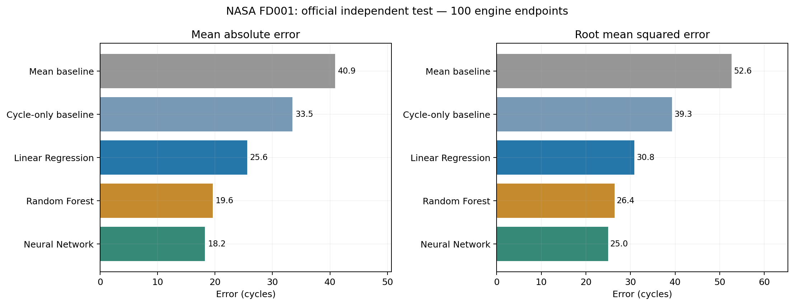

# MMA3001 — Turbofan Engine Remaining Useful Life Prediction

**NASA C-MAPSS FD001 | Python | Machine learning | Predictive maintenance**

This project investigates whether measurements from simulated turbofan engine sensors can predict **remaining useful life (RUL)**, expressed in operating cycles. It compares two simple baselines with Linear Regression, Random Forest Regression and a feedforward Neural Network. All analysis is based on the **FD001 subset** of NASA's C-MAPSS benchmark.


## Start here: Python version

**[Open the Python-only project →](MMA3001_Turbofan_RUL_Python/README.md)**

The Python folder contains standalone scripts for all four stages, a `run_all.py` launcher, reproducibility instructions, saved figures, validation tables and final test results. **Jupyter Notebook is not required.**

| Stage | Script | Purpose |
|---|---|---|
| 1 | [Data exploration](MMA3001_Turbofan_RUL_Python/stage1/01_Data_Exploration.py) | Inspect engine lifetimes and sensor degradation |
| 2 | [Preprocessing](MMA3001_Turbofan_RUL_Python/stage2/02_Data_Preprocessing.py) | Prepare engine-wise splits, features and RUL labels |
| 3 | [Model training](MMA3001_Turbofan_RUL_Python/stage3/03_Model_Training.py) | Compare baselines, Linear Regression, Random Forest and MLP |
| 4 | [Final evaluation](MMA3001_Turbofan_RUL_Python/stage4/04_Final_Evaluation.py) | Evaluate fixed models on NASA's 100 test-engine endpoints |

## Key results

| Method | MAE (cycles) ↓ | RMSE (cycles) ↓ | R² ↑ |
|---|---:|---:|---:|
| **Neural Network (MLP)** | **18.24** | **24.96** | **0.639** |
| Random Forest | 19.58 | 26.41 | 0.596 |
| Linear Regression | 25.58 | 30.84 | 0.449 |
| Cycle-only baseline | 33.46 | 39.31 | 0.105 |
| Mean baseline | 40.88 | 52.63 | -0.604 |

The neural network had the lowest observed error on the 100 official test engines. However, it **overestimated RUL for 64 of 100 engines**, which is important when interpreting predictions for maintenance decisions. The difference between the neural network and Random Forest is small and should not be overinterpreted.



## How to run (Python 3.10+)

Clone or download this repository, open a terminal at the repository root and run:

```bash
cd MMA3001_Turbofan_RUL_Python
python -m pip install -r requirements.txt
python run_all.py --archive "/path/to/CMAPSSData.zip"
```

Get the original C-MAPSS dataset from the [NASA Prognostics Data Repository](https://www.nasa.gov/intelligent-systems-division/discovery-and-systems-health/pcoe/pcoe-data-set-repository/). The dataset is **not included** in this repository. See the [Python README](MMA3001_Turbofan_RUL_Python/README.md) for Windows PowerShell setup and more detailed instructions.

## Other files

- [Original notebook-based project](MMA3001_Turbofan_RUL_GitHub_Ready/MMA3001_Turbofan_RUL_GitHub/) — retained for reference; the Python version above is the recommended starting point.
- The original ZIP upload is retained as an archive.
- [Stage 4 metrics](MMA3001_Turbofan_RUL_Python/stage4/results/official_test_metrics.csv) and [test predictions](MMA3001_Turbofan_RUL_Python/stage4/results/official_test_predictions_by_engine.csv) are available as CSV files.

## Scope and caveats

This is an **academic numerical methods / machine learning investigation**, not a flight-certified maintenance tool. C-MAPSS contains simulated run-to-failure observations, and FD001 represents one operating regime and one fault mode. The models are not validated on real aircraft telemetry or a specific Airbus A320 engine.

**Data citation:** Saxena, A. and Goebel, K. (2008), *Turbofan Engine Degradation Simulation Data Set*, NASA Ames Research Center / Prognostics Data Repository.
