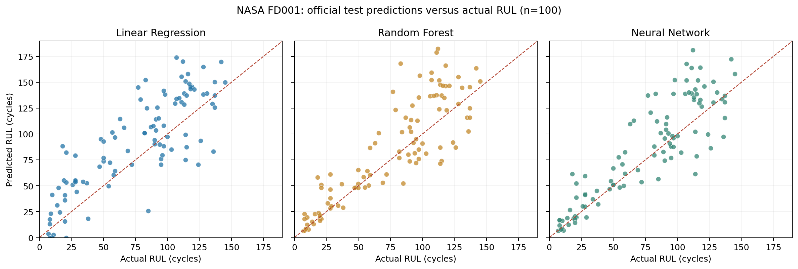

# MMA3001 Project — Turbofan Engine Remaining Useful Life Prediction

**MMA3001 numerical methods and machine learning project**  
**Task:** Predict the remaining useful life (RUL) of simulated turbofan engines in **operating cycles** from sensor observations.



## Overview

This project investigates whether sensor-informed regression models predict simulated engine degradation more accurately than a cycle-only model. The NASA C-MAPSS **FD001** subset contains one operating condition and one fault mode (high-pressure compressor degradation).

**Inputs:** current operating cycle and 14 selected sensor channels (after excluding seven near-constant/constant channels). Engine ID is used for grouping, **not** as a predictor.  
**Output:** remaining useful life in cycles. For complete training histories, `RUL = failure_cycle - current_cycle`.

The modelling pipeline compares five methods:

1. Mean-RUL baseline
2. Cycle-only linear regression baseline
3. Multivariate Linear Regression
4. Random Forest Regression
5. Feedforward Neural Network (MLP)

## Official FD001 test results

The models were fixed using an engine-disjoint development/validation split, then refitted on all 100 training engines and evaluated once on the 100 official test-engine endpoints. RUL targets are **uncapped** and predictions are clipped to nonnegative values.

| Model | MAE (cycles) ↓ | RMSE (cycles) ↓ | R² ↑ |
|:--|--:|--:|--:|
| **Neural Network** | **18.24** | **24.96** | **0.639** |
| Random Forest | 19.58 | 26.41 | 0.596 |
| Linear Regression | 25.58 | 30.84 | 0.449 |
| Cycle-only baseline | 33.46 | 39.31 | 0.105 |
| Mean baseline | 40.88 | 52.63 | -0.604 |

The Neural Network improved MAE by approximately **45.5%** relative to the cycle-only baseline. Its advantage over Random Forest was much smaller (**1.35 cycles MAE**), and a paired bootstrap interval included zero; do not interpret this result as decisive superiority over Random Forest.

**Maintenance caveat:** The Neural Network overestimated RUL on **64/100** engines and had a mean signed error of **+9.94 cycles**. These are simulated benchmark results, **not** a certified real-aircraft prognostics system.


## Project organisation (Python scripts only)

```text
MMA3001-Project/
├── README.md
├── run_all.py                    # Run all four stages automatically
├── requirements.txt
├── .gitignore
├── scripts/
│   ├── setup_dataset.py         # Extract NASA FD001 data from ZIP
│   └── sync_stage3_data.py      # Transfer Stage 2 data to Stage 3
├── stage1/
│   ├── 01_Data_Exploration.py   # Inspect engines, sensors and correlations
│   └── figures/
├── stage2/
│   ├── 02_Data_Preprocessing.py # Engineer-level split, labels, features
│   └── figures/
├── stage3/
│   ├── 03_Model_Training.py     # Baselines, Linear, RF and MLP
│   ├── results/
│   └── figures/
├── stage4/
│   ├── 04_Final_Evaluation.py   # Official NASA test evaluation
│   ├── results/
│   └── figures/
└── docs/
```

**All four stages are ordinary `.py` files**, not Jupyter notebooks. Figures are
saved as `.png` automatically, and tables/metrics are saved as `.csv`. No IDE or
notebook server is required.

## Run the project (Windows PowerShell)

Install **Python 3.10+**, then clone or download this repository. Open PowerShell in the
project root and run:

```powershell
py -3 -m venv .venv
.\.venv\Scripts\Activate.ps1
python -m pip install -r requirements.txt
```

Download the NASA C-MAPSS archive from the
[NASA Prognostics Data Repository](https://www.nasa.gov/intelligent-systems-division/discovery-and-systems-health/pcoe/pcoe-data-set-repository/).
The outer ZIP or the enclosed `CMAPSSData.zip` is supported. Then run:

```powershell
python run_all.py --archive "C:\path\to\CMAPSSData.zip"
```

The entire pipeline runs in order: exploration → preprocessing → validation
model fitting → independent NASA test evaluation. Depending on your computer,
training the Neural Network may take several minutes. You can re-run without
`--archive` after the data has been extracted once:

```powershell
python run_all.py
```

### Or run each stage separately

```powershell
python scripts/setup_dataset.py "C:\path\to\CMAPSSData.zip"
python stage1/01_Data_Exploration.py
python stage2/02_Data_Preprocessing.py
python scripts/sync_stage3_data.py
python stage3/03_Model_Training.py
```

After Stage 3, copy `stage3/results/stage3_model_decision.json` to
`stage4/data/stage3_model_decision.json` before running:

```powershell
python stage4/04_Final_Evaluation.py
```

The `run_all.py` option does the copy automatically. Stage 4 is the **only** step
that uses the official NASA `RUL_FD001.txt` test targets for evaluation.
For consistency with the reported results, use the same library versions and
random seeds. Results can vary slightly between environments.

### Experimental design and data leakage controls

- Split the 100 complete training engines into **80 development engines and 20 independent validation engines**; never randomly split rows from the same engine across groups.
- Score model selection on one artificially censored observation per validation engine (20 validation predictions).
- Fit any feature standardisation on training engines only.
- Fix model configurations before using the 100 official test-engine RUL labels.
- Refit each model on all 100 training engines; evaluate one final available sensor observation per official test engine.
- Examine overestimation separately because high RUL forecasts can be problematic for maintenance planning.

## Limitations

This dataset contains simulated turbofan engine measurements, not operational telemetry collected from in-service aircraft engines. The predictions concern a single FD001 fault scenario, not all engine failures. Validation covers only a small number of held-out engines and there is substantial uncertainty, especially for a safety-critical maintenance decision.

## MMA3001 repository assessment deliverables

| Requirement | Location |
|---|---|
| README | This file |
| HTML source documentation | [docs/html/index.html](docs/html/index.html), generated by AST-based source documentation (similar purpose to pdoc) |
| Licensing agreement | [MIT LICENSE](LICENSE), covering original code/documentation, not NASA's data |
| Functional Python source on main | [run_all.py](run_all.py), [stage1](stage1/), [stage2](stage2/), [stage3](stage3/), [stage4](stage4/), [scripts](scripts/) |
| Automated tests and test report | [tests](tests/), [HTML test report](docs/test_report.html), [JUnit XML](docs/test-results.xml) |

To regenerate all documentation and test evidence locally:

```bash
python -m pip install -r requirements-dev.txt
python scripts/generate_docs.py
python -m pytest -q --junitxml=docs/test-results.xml --html=docs/test_report.html --self-contained-html
```

The GitHub Actions workflow runs these checks on pushes and pull requests and publishes the generated reports to the main branch after a successful push. HTML source documentation is generated by parsing code rather than importing training scripts, which would otherwise execute long computations. Tests use synthetic inputs for integrity checks; model results are separately checked against the saved 100-engine prediction CSV.

**License boundary:** MIT applies to original software and repository documentation; the NASA dataset and third-party libraries remain subject to their respective terms. These models are not certified for operational aircraft maintenance.

## Dataset source and attribution

Saxena, A. and Goebel, K. (2008), **Turbofan Engine Degradation Simulation Data Set**, NASA Prognostics Data Repository, NASA Ames Research Center, Moffett Field, CA. [Original NASA dataset page](https://www.nasa.gov/intelligent-systems-division/discovery-and-systems-health/pcoe/pcoe-data-set-repository/).

The dataset and NASA software are not produced by this repository. The original dataset's redistribution terms have not been independently verified, so the repository provides download/preparation instructions instead of republishing the raw files. Repository analysis and explanations are for academic demonstration; do not use them for flight-critical decisions.
